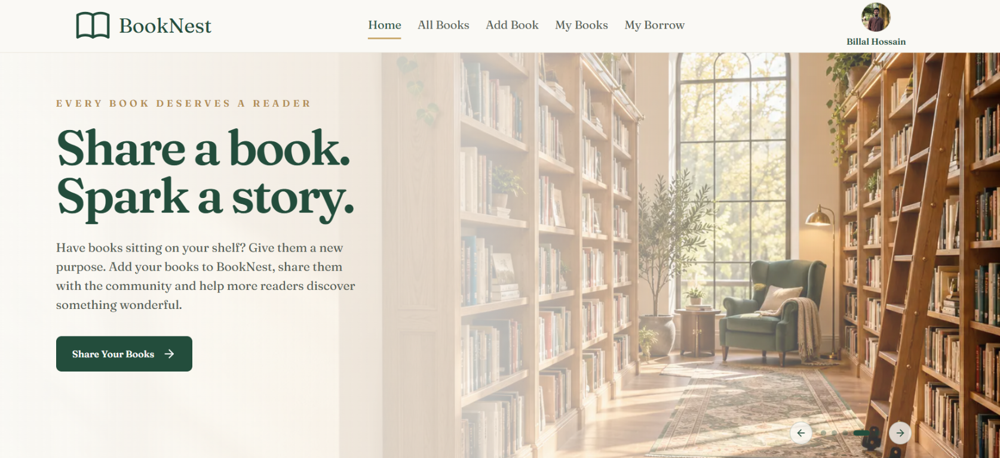
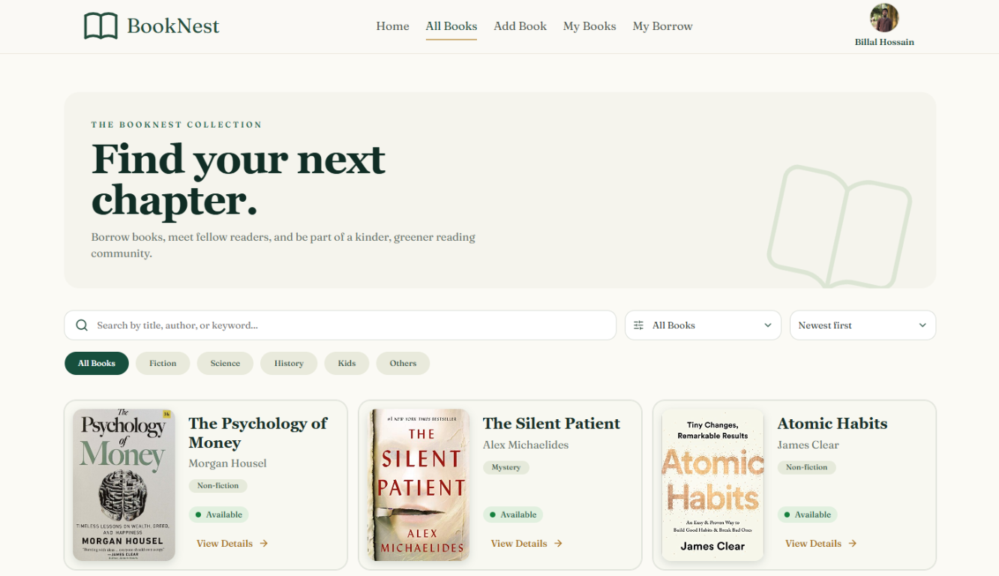
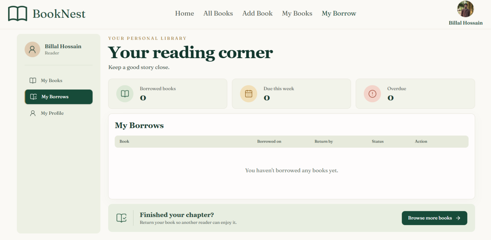

<div align="center">

# BookNest

### Discover. Share. Borrow. Read.

A modern community library platform for discovering books, sharing personal collections, and managing borrowing activity.

[](https://booknest-client-seven.vercel.app/)
[](https://nextjs.org/)
[](https://react.dev/)
[](https://www.typescriptlang.org/)

**[Explore the live application](https://booknest-client-seven.vercel.app/)**

</div>

## Table of Contents

- [About the Project](#about-the-project)
- [Key Features](#key-features)
- [Technology Stack](#technology-stack)
- [Application Flow](#application-flow)
- [Screenshots](#screenshots)
- [Routes](#routes)
- [Getting Started](#getting-started)
- [Environment Variables](#environment-variables)
- [Backend API Contract](#backend-api-contract)
- [Available Scripts](#available-scripts)
- [Project Structure](#project-structure)
- [Authentication and Security](#authentication-and-security)
- [Deployment](#deployment)
- [Contributing](#contributing)
- [License](#license)

## About the Project

BookNest connects readers through a simple digital library experience. Visitors can explore the public catalog and book details, while registered users can share books, borrow from the community, manage their collection, and return borrowed titles.

The application is built with the Next.js App Router and uses Better Auth for account management, MongoDB for authentication persistence, and a separate backend API for book and borrowing operations.

## Key Features

### For readers

- Browse the complete book catalog.
- Search by title, author, or keyword.
- Filter by category and sort by publication date.
- View book details and request available books.
- Track borrowed books, due dates, and return status.

### For contributors

- Add books to the community collection.
- Provide title, author, category, language, publication year, ISBN, description, and cover image.
- Upload JPG or PNG book covers up to 5 MB.
- View and filter books shared by the current user.

### Platform features

- Email/password authentication with Better Auth.
- Google and Facebook social authentication support.
- Password recovery through Resend.
- JWT-backed authenticated API requests.
- Protected member-only routes.
- Responsive, mobile-first interface.
- Reusable UI components and toast-based feedback.

## Technology Stack

| Category | Technology |
| --- | --- |
| Framework | Next.js 16 with App Router |
| Language | TypeScript |
| UI | React 19, Tailwind CSS 4 |
| Authentication | Better Auth with JWT plugin |
| Persistence | MongoDB adapter for Better Auth |
| Icons | Lucide React, Tabler Icons |
| Email | Resend |
| Notifications | Sonner |
| Build and development | Turbopack, React Compiler |
| Code quality | ESLint |

## Application Flow

```text
Visitor
  ├── Explore the catalog
  ├── Search and filter books
  └── View book details

Registered member
  ├── Add books to the community library
  ├── Borrow available books
  ├── Manage shared books
  └── Track and return borrowed books
```

## Screenshots

<table>
  <tr>
    <td align="center"><strong>Home</strong></td>
    <td align="center"><strong>All Books</strong></td>
    <td align="center"><strong>My Borrows</strong></td>
  </tr>
  <tr>
    <td></td>
    <td></td>
    <td></td>
  </tr>
</table>

## Routes

| Route | Description | Access |
| --- | --- | --- |
| `/` | Landing page, new arrivals, and onboarding | Public |
| `/all-books` | Searchable and filterable book catalog | Public |
| `/all-books/[id]` | Book details and borrowing action | Public |
| `/sign-in` | Existing user sign-in | Public |
| `/sign-up` | New account registration | Public |
| `/forgot-password` | Password reset request | Public |
| `/reset-password` | Password reset completion | Auth flow |
| `/profile` | Account profile management | Protected |
| `/add-books` | Add a book to the library | Protected |
| `/my-books` | Manage books shared by the user | Protected |
| `/my-borrows` | View and return borrowed books | Protected |

## Getting Started

### Prerequisites

- Node.js 20 or later
- npm 10 or later
- A running BookNest backend API
- MongoDB database access
- Resend API access for password reset emails
- OAuth credentials, if social login is enabled

### Installation

```bash
git clone https://github.com/billalhossain404/booknest-client.git
cd booknest-client
npm install
```

### Configure the environment

Create a `.env.local` file in the project root and add the variables described in [Environment Variables](#environment-variables).

### Run locally

```bash
npm run dev
```

Open [http://localhost:3000](http://localhost:3000) to use the application.

## Environment Variables

| Variable | Required | Description |
| --- | --- | --- |
| `NEXT_PUBLIC_API_URL` | Yes | Base URL of the BookNest backend API |
| `BETTER_AUTH_URL` | Yes | Canonical URL of the frontend auth server |
| `NEXT_PUBLIC_BETTER_AUTH_URL` | Yes | Client-side Better Auth URL |
| `BETTER_AUTH_SECRET` | Yes | Secret used to sign and protect auth data |
| `BETTER_AUTH_DB_URL` | Yes | MongoDB connection string for Better Auth |
| `RESEND_API_KEY` | Yes | Resend key used for password reset emails |
| `GOOGLE_CLIENT_ID` | Optional | Google OAuth client ID |
| `GOOGLE_CLIENT_SECRET` | Optional | Google OAuth client secret |
| `FACEBOOK_CLIENT_ID` | Optional | Facebook OAuth client ID |
| `FACEBOOK_CLIENT_SECRET` | Optional | Facebook OAuth client secret |

Example:

```env
NEXT_PUBLIC_API_URL=http://localhost:5000
BETTER_AUTH_URL=http://localhost:3000
NEXT_PUBLIC_BETTER_AUTH_URL=http://localhost:3000
BETTER_AUTH_SECRET=replace-with-a-long-random-secret
BETTER_AUTH_DB_URL=mongodb://127.0.0.1:27017/booknest
RESEND_API_KEY=re_xxxxxxxxx
```

Never commit `.env.local` or production credentials. Environment files are ignored by the repository.

## Backend API Contract

The frontend uses `NEXT_PUBLIC_API_URL` as the backend base URL.

| Method | Endpoint | Purpose |
| --- | --- | --- |
| `GET` | `/all-books` | Load all books and new arrivals |
| `GET` | `/all-books/:id` | Load a single book |
| `POST` | `/add-books` | Add a book for the authenticated owner |
| `GET` | `/my-books/:userId` | Load books owned by a user |
| `POST` | `/bookings` | Create a borrowing request |
| `GET` | `/my-bookings/:email` | Load a user's borrowed books |
| `DELETE` | `/all-bookings/:id` | Return a borrowed book |

Protected create and borrowing requests include the Better Auth JWT in the `Authorization` header. The backend must validate the token and enforce authorization independently; frontend route protection must not be treated as the only security boundary.

## Available Scripts

| Command | Description |
| --- | --- |
| `npm run dev` | Start the development server |
| `npm run build` | Create an optimized production build |
| `npm run start` | Start the production server |
| `npm run lint` | Run ESLint |

Recommended validation before submitting changes:

```bash
npm run lint
npm run build
```

## Project Structure

```text
src/
├── app/
│   ├── (auth)/                 # Sign-in, sign-up, recovery, and profile pages
│   ├── all-books/              # Catalog and book detail pages
│   ├── add-books/              # Add-book form
│   ├── my-books/               # User's shared collection
│   ├── my-borrows/             # Borrowing history and return actions
│   ├── api/auth/[...all]/      # Better Auth route handler
│   ├── globals.css             # Global styles
│   ├── layout.tsx              # Root layout and global metadata
│   └── page.tsx                # Home page
├── components/                 # Shared sections, booking, and UI components
├── lib/
│   ├── auth.ts                 # Server-side auth configuration
│   ├── auth-client.ts          # Client-side auth helpers
│   └── getTokenFrom*.ts        # Token utilities
└── proxy.ts                    # Protected route session guard
```

## Authentication and Security

- Better Auth manages user accounts and sessions.
- MongoDB stores Better Auth data through the MongoDB adapter.
- JWT support is enabled for authenticated backend requests.
- Member-only routes redirect unauthenticated users to `/sign-in`.
- Password reset emails are sent through Resend.
- Backend authorization must validate the authenticated user and resource ownership for every protected operation.

## Deployment

BookNest can be deployed to Vercel or any Node.js-compatible hosting provider.

1. Configure all required production environment variables.
2. Set `NEXT_PUBLIC_API_URL` to the deployed backend URL.
3. Set both Better Auth URL variables to the deployed frontend URL.
4. Configure production OAuth callback URLs when social login is enabled.
5. Build and start the application:

   ```bash
   npm run build
   npm run start
   ```

The current live deployment is available at [booknest-client-seven.vercel.app](https://booknest-client-seven.vercel.app/).

## Contributing

1. Create a focused feature branch.
2. Follow the existing TypeScript, React, and component conventions.
3. Keep secrets and environment files out of commits.
4. Run `npm run lint` and `npm run build`.
5. Open a pull request with a clear summary and validation details.

## License

No license has been declared for this repository yet. Contact the repository owner before redistributing or using the project commercially.
