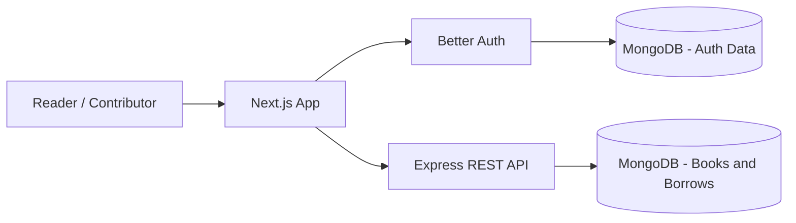

<div align="center">

# 📚 BookNest

### Discover. Share. Borrow. Read.

**A community-powered digital library for finding your next read, sharing your collection, and keeping borrowing simple.**

[](https://booknest-client-seven.vercel.app/)
[](https://github.com/billalhossain404/booknest-client)


**[Live Website](https://booknest-client-seven.vercel.app/)** · **[Frontend Repository](https://github.com/billalhossain404/booknest-client)**

</div>

---

## ✨ Overview

**BookNest** is a responsive online library and book-sharing application that brings readers together. Visitors can explore a searchable book collection, and members can contribute titles, view book information, borrow books, manage their shared collection, and follow their borrowing history.

The application combines a **Next.js App Router frontend**, **Better Auth with MongoDB-backed sessions**, and a **separate Express.js + MongoDB API** for library operations. The frontend is deployed on **Vercel**.

> **Repository scope:** This repository contains the **frontend / Next.js authentication application**. The Express API is a separate service and must be running for book and borrowing features to work locally.

### At a glance

| Discover                            | Share                                  | Borrow                                   | Manage                                          |
| :---------------------------------- | :------------------------------------- | :--------------------------------------- | :---------------------------------------------- |
| Explore and search the book catalog | Add a book with its cover and metadata | Request a book and track its return date | View personal books, loans, and account details |

## 🖼️ Preview

<div align="center">

### Home


<br />
<br />

<table>
  <tr>
    <td align="center"><strong>Explore Books</strong></td>
    <td align="center"><strong>My Borrows</strong></td>
  </tr>
  <tr>
    <td></td>
    <td></td>
  </tr>
</table>

</div>

## 🚀 Features

### 📖 Explore the library

- **Book catalog:** Browse books with cover images, titles, authors, and categories.
- **Search and discovery:** Search by title, author, or keyword; use category filters and sorting controls.
- **Individual book pages:** Read descriptions, view additional metadata, and access the borrowing interface.
- **Home experience:** Five auto-rotating hero slides with navigation controls, a dynamically loaded New Arrivals section, and a three-step _How It Works_ guide.
- **New Arrivals:** Displays a selection of books ordered by publication year in the current implementation.

### 👤 Accounts and authentication

- Email/password registration and login powered by **Better Auth**.
- Social sign-in options for **Google** and **Facebook**, subject to provider configuration.
- Account sessions persisted using the **Better Auth MongoDB adapter**.
- Password-reset email flow integrated with **Resend**.
- Member-only routes, profile management, and a signed-in account experience.
- Form validation, clear feedback, and reusable notification components.

### 📚 Share and manage books

- Add book details, including **title, author, category, description, language, publication year, ISBN, and cover URL**.
- Select a JPG/PNG cover image with client-side preview and validation (up to **5 MB**).
- View books contributed by your account in **My Books**.
- Search and filter your contributed collection.

### 🔖 Borrowing experience

- Review a book's available-copy information when supplied by the API.
- Request books from their detail pages and receive success or error feedback.
- View borrowed titles with borrowing dates, return dates, and loan status.
- See borrowed-book counts, items due soon, and overdue counts.
- Return borrowed books from **My Borrows**.

### 🎨 User experience

- Responsive layouts for mobile, tablet, and desktop.
- Consistent shared navbar, footer, book cards, dialogs, and form styling.
- Loading, empty, and error states for data-driven screens.
- Reusable UI components and accessible image descriptions.
- Page metadata, Open Graph information, and branded favicon configuration.

## 🛠️ Tech Stack

| Layer             | Technology                                                  |
| :---------------- | :---------------------------------------------------------- |
| Frontend          | **Next.js 16** (App Router), **React 19**, **TypeScript 5** |
| Styling           | **Tailwind CSS 4**, **shadcn/ui**, Base UI                  |
| Authentication    | **Better Auth**, MongoDB adapter, JWT plugin                |
| Backend service   | **Node.js**, **Express.js**, REST API (separate project)    |
| Database          | **MongoDB**                                                 |
| Icons             | **Lucide React**, **Tabler Icons**, React Icons             |
| Email integration | **Resend** (password recovery)                              |
| Feedback          | Toast notifications, reusable modal/dialog components       |
| Tooling           | **ESLint**, Turbopack, React Compiler                       |
| Hosting           | **Vercel** (frontend)                                       |

## 🏗️ Architecture



**Authentication** lives in the Next.js application. **Catalog and borrowing data** are requested from the independent Express backend through `NEXT_PUBLIC_API_URL`. The backend should independently validate JWTs and ownership on every protected operation; hiding a page in the frontend is not a substitute for backend authorization.

## 🧭 Application Routes

The following are the **actual frontend paths**, which are intentionally documented as implemented rather than renamed to match a separate assignment brief.

| Page            | Route              | Access                              |
| :-------------- | :----------------- | :---------------------------------- |
| Home            | `/`                | Public                              |
| All Books       | `/all-books`       | Public                              |
| Book Details    | `/all-books/[id]`  | Member route in current route guard |
| Sign In         | `/sign-in`         | Public                              |
| Sign Up         | `/sign-up`         | Public                              |
| Forgot Password | `/forgot-password` | Public                              |
| Reset Password  | `/reset-password`  | Recovery flow                       |
| My Profile      | `/profile`         | Protected                           |
| Add Book        | `/add-books`       | Protected                           |
| My Books        | `/my-books`        | Protected                           |
| My Borrows      | `/my-borrows`      | Protected                           |

## ⚙️ Getting Started

### Prerequisites

- **Node.js 20+** and a compatible **npm** installation.
- A running **MongoDB** instance or MongoDB Atlas cluster.
- A running **BookNest Express backend** for the library API.
- Google/Facebook OAuth credentials if those providers are enabled.
- A **Resend** API key for password-reset emails.

### 1. Clone the frontend

```bash
git clone https://github.com/billalhossain404/booknest-client.git
cd booknest-client
npm install
```

### 2. Configure environment variables

Create a **`.env.local`** file in the project root:

```dotenv
# Backend API (replace the port if your Express server uses another one)
NEXT_PUBLIC_API_URL=http://localhost:8000

# Better Auth / frontend origin
BETTER_AUTH_URL=http://localhost:3000
NEXT_PUBLIC_BETTER_AUTH_URL=http://localhost:3000
BETTER_AUTH_SECRET=replace-with-a-long-random-secret
BETTER_AUTH_DB_URL=mongodb://127.0.0.1:27017/booknest

# Password-reset email integration
RESEND_API_KEY=re_replace_with_your_key

# Optional: Google OAuth
GOOGLE_CLIENT_ID=
GOOGLE_CLIENT_SECRET=

# Optional: Facebook OAuth
FACEBOOK_CLIENT_ID=
FACEBOOK_CLIENT_SECRET=
```

| Variable                                        | Purpose                                                  |
| :---------------------------------------------- | :------------------------------------------------------- |
| `NEXT_PUBLIC_API_URL`                           | Base URL of the separate Express API                     |
| `BETTER_AUTH_URL`                               | Frontend's canonical authentication origin               |
| `NEXT_PUBLIC_BETTER_AUTH_URL`                   | Auth endpoint origin used outside the browser            |
| `BETTER_AUTH_SECRET`                            | Secret protecting Better Auth credentials and sessions   |
| `BETTER_AUTH_DB_URL`                            | MongoDB connection string for authentication persistence |
| `RESEND_API_KEY`                                | Password-reset email provider credential                 |
| `GOOGLE_CLIENT_ID` / `GOOGLE_CLIENT_SECRET`     | Google OAuth credentials                                 |
| `FACEBOOK_CLIENT_ID` / `FACEBOOK_CLIENT_SECRET` | Facebook OAuth credentials                               |

> **Security:** Never commit `.env.local`, database credentials, API keys, or OAuth secrets. The sample values above are placeholders. Configure the matching frontend domain and OAuth callback URLs in production.

### 3. Start both services

Start your **Express backend** according to its own setup instructions, then run the Next.js application:

```bash
npm run dev
```

Visit **http://localhost:3000**.

### 4. Build for production

```bash
npm run lint
npm run build
npm run start
```

## 🔌 API Reference

The frontend communicates with the backend through the following **currently referenced endpoints**. These are not the same URL names as the original assignment's suggested API contract.

| Method   | Endpoint              | Used for                                      |
| :------- | :-------------------- | :-------------------------------------------- |
| `GET`    | `/all-books`          | List books; populate catalog and New Arrivals |
| `GET`    | `/all-books/:id`      | Fetch book details                            |
| `POST`   | `/add-books`          | Create a book                                 |
| `GET`    | `/my-books/:userId`   | Retrieve books contributed by a user          |
| `POST`   | `/bookings`           | Submit a borrow request                       |
| `GET`    | `/my-bookings/:email` | Retrieve a user's borrowing records           |
| `DELETE` | `/all-bookings/:id`   | Return a borrowed book                        |

All endpoints are relative to `NEXT_PUBLIC_API_URL`. The frontend currently attaches a Better Auth-issued JWT when creating a book; ensure **every** private read/write endpoint verifies the caller on the backend before deploying to production.

### Core data concepts

| Entity    | Representative fields                                                                                   |
| :-------- | :------------------------------------------------------------------------------------------------------ |
| Book      | `title`, `author`, `category`, `description`, `bookUrl`, `publishedYear`, `language`, `isbn`, `ownerId` |
| Borrow    | Book reference/details, `userEmail`, borrowing date, return date                                        |
| Auth user | Name, email, profile image, provider/session data managed by Better Auth                                |

Exact database field names and validation rules are owned by the Express backend. Keep the API request/response shapes synchronized between the projects.

## 🗂️ Project Structure

```text
booknest-client/
├── public/
│   └── screenshots/           # README preview images
├── src/
│   ├── app/
│   │   ├── (auth)/             # Sign-in, sign-up, recovery, profile
│   │   ├── all-books/          # Catalog and individual book pages
│   │   ├── add-books/          # Add-book form
│   │   ├── my-books/           # Member's contributed books
│   │   ├── my-borrows/         # Borrowing history and return flow
│   │   ├── api/auth/[...all]/  # Better Auth API handler
│   │   ├── layout.tsx          # Site-wide shell and metadata
│   │   ├── globals.css         # Global styling
│   │   └── page.tsx            # Home page
│   ├── components/             # Banner, cards, navbar, footer, UI
│   ├── lib/
│   │   ├── auth.ts            # Server-side Better Auth config
│   │   └── auth-client.ts     # Client-side authentication helpers
│   └── proxy.ts                # Route access guard
├── package.json
└── README.md
```

_The structure is summarized to show the important project areas, not every file._

## 🎨 Design System

BookNest uses a quiet editorial style inspired by libraries and printed books: calm surfaces, green accents, warm gold highlights, and generous whitespace.

| Element              | Choice                                  |
| :------------------- | :-------------------------------------- |
| Primary              | Deep forest green `#234D3C`             |
| Accent               | Warm muted gold `#B18B4F`               |
| Background           | Soft ivory `#FAF9F5`                    |
| Display typography   | **Fraunces**                            |
| Interface typography | **Geist**                               |
| Visual direction     | Editorial, clean, welcoming, responsive |

## ✅ Local Validation

Run the code-quality and production checks:

```bash
npm run lint
npm run build
```

Recommended manual smoke test: browse the catalog, open a book, register/login, add a book, open **My Books**, borrow and return a book, check member redirects, and inspect the layout on mobile and desktop. Validate all borrowing and inventory rules against the running Express API.

## 🌍 Deployment

**Frontend:** [booknest-client-seven.vercel.app](https://booknest-client-seven.vercel.app/)

To deploy your own copy:

1. Deploy the **Express.js backend** and configure its MongoDB connection.
2. Set `NEXT_PUBLIC_API_URL` to the public API origin.
3. Configure `BETTER_AUTH_URL`, `NEXT_PUBLIC_BETTER_AUTH_URL`, and the relevant secrets for the frontend origin.
4. Add production OAuth callback URLs and configure the password-reset sender if using those features.
5. Deploy the frontend to Vercel and test authentication, API CORS, and protected operations on the live domains.

## 🤝 Contributing

Suggestions and improvements are welcome through GitHub Issues or Pull Requests.

1. Fork the project and create a feature branch.
2. Make a focused change using the existing TypeScript and component conventions.
3. Run `npm run lint` and `npm run build`.
4. Open a pull request describing the change and how it was tested.

## 📄 License

**No license file has been declared for this repository.** Please contact the repository owner before reusing or distributing the source code.

---

<div align="center">

**Made for readers, built around sharing.** 📖

[Back to top ↑](#-booknest) · [Explore BookNest](https://booknest-client-seven.vercel.app/)

</div>
